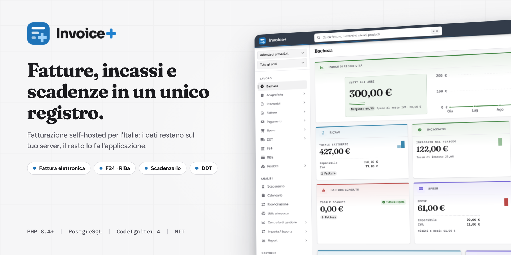
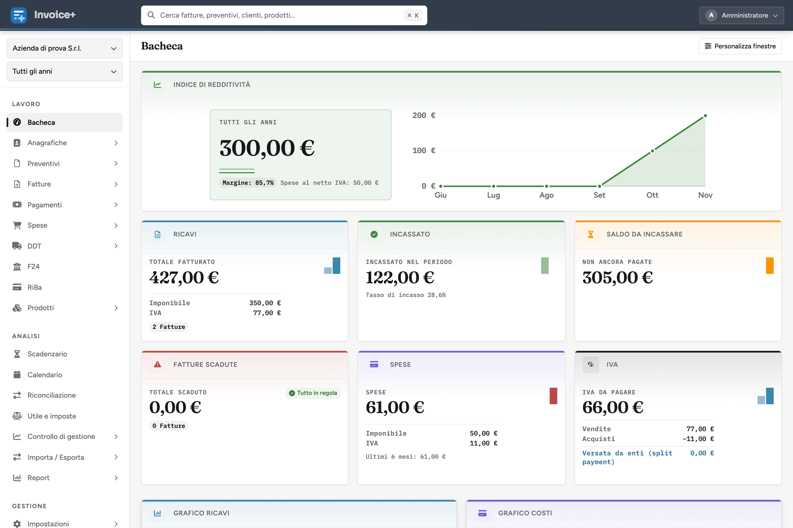
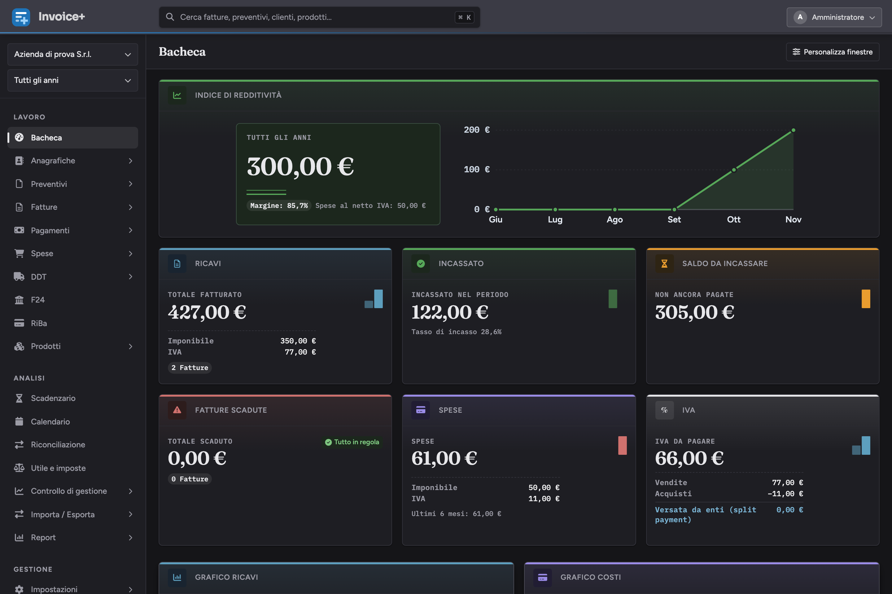
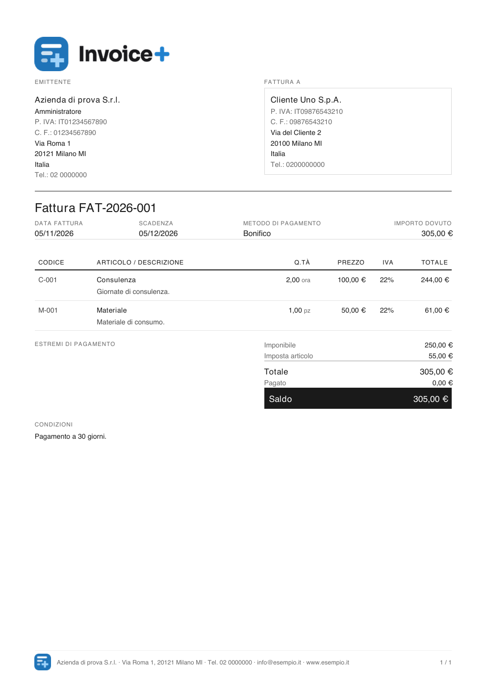
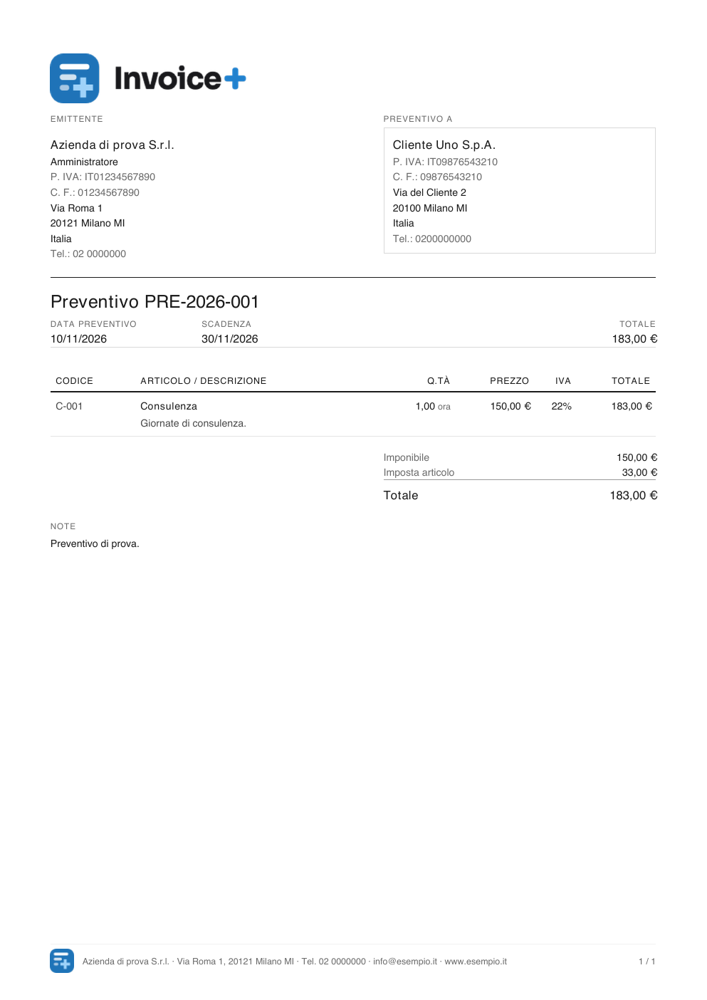

<p align="center">
  <a href="https://github.com/iacos93/invoiceplus">
    <picture>
      <source media="(prefers-color-scheme: dark)" srcset="public/assets/core/img/logo_400x200-dark.png">
      
    </picture>
  </a>

  <p align="center">
    La fatturazione self-hosted per chi lavora in Italia: fatture, preventivi,
    incassi e scadenze in un unico registro.
    <br>
    <br>
    <a href="docs/funzioni.md">Documentazione</a>
    &middot;
    <a href="#installazione">Installazione</a>
    &middot;
    <a href="https://github.com/iacos93/invoiceplus/issues">Segnalazioni</a>
  </p>
</p>

[](https://github.com/iacos93/invoiceplus/actions/workflows/ci.yml)
[](LICENSE)
[](https://www.php.net)
[](https://codeigniter.com)



Invoice+ è un'applicazione web **self-hosted** per gestire la fatturazione di
una piccola azienda o di uno studio: anagrafiche, preventivi, fatture, DDT,
incassi, spese e scadenze, con i dati che restano sul tuo server.

Nasce come porting su [CodeIgniter 4](https://codeigniter.com) di
[InvoicePlane](https://invoiceplane.com), di cui conserva il modello dei dati e
buona parte del flusso di lavoro, aggiungendo gli adattamenti che servono in
Italia: fattura elettronica e canale SDI, F24, RiBa, split payment, ritenute e
cassa previdenziale. L'interfaccia è in italiano e in inglese.

> **Stato: in sviluppo.** Le funzioni principali sono utilizzabili e coperte da
> test, ma il progetto non è ancora dichiarato stabile per l'uso in produzione
> su dati reali senza backup.
>
> Per la 1.0 mancano prove che i test automatici non possono dare: un invio
> reale allo SdI con ricevuta, la ricezione reale di una fattura di acquisto
> (il codice c'è, è coperto da test e fu provato con uno SdI simulato, ma serve
> l'accreditamento SOGEI per provarlo con quello vero), un ripristino del
> backup su un server vero e un periodo di uso con le automazioni installate.
> Fino ad allora ogni invio allo SdI, ogni fattura ricevuta e ogni flusso
> bancario va controllato a mano la prima volta.

<!-- TOC depthFrom:2 depthTo:6 orderedList:false updateOnSave:true withLinks:true -->

- [Funzioni principali](#funzioni-principali)
- [Schermate](#schermate)
- [Documentazione](#documentazione)
- [Requisiti software](#requisiti-software)
- [Requisiti hardware](#requisiti-hardware)
- [Installazione rapida](#installazione-rapida)
- [Prova in locale](#prova-in-locale)
- [Installazione](#installazione)
- [Versioni](#versioni)
- [Strumenti di sviluppo e debug](#strumenti-di-sviluppo-e-debug)
- [Test](#test)
- [Community e supporto](#community-e-supporto)
- [Contribuire](#contribuire)
- [Licenza e attribuzione](#licenza-e-attribuzione)

<!-- /TOC -->

## Funzioni principali

- **Anagrafiche** clienti e fornitori, con schede, ricerca e collegamento ai
  documenti.
- **Preventivi, fatture, DDT**, pagamenti, spese e prodotti, con calcolo di
  totali, imposte e sconti.
- **Fatturazione italiana**: F24, RiBa, scadenzario, invio dei documenti via
  PEC e canale SDI.
- **Riconciliazione bancaria** con importazione degli estratti conto.
- **PDF** dei documenti con modelli sovrascrivibili e nomi file configurabili,
  con l'aliquota IVA di ogni riga.
- **Più aziende** sulla stessa installazione, ciascuna con il proprio logo
  (esteso nell'intestazione, solo segno nel piè di pagina) e il proprio testo di
  piè di pagina su fatture, preventivi, DDT e report.
- **Area guest**: link temporanei per far vedere a un cliente i propri
  documenti senza creargli un account.
- **Accesso**: sessioni, modulo MFA e passkey (WebAuthn).
- **Calendario** delle scadenze, esportabile in formato iCalendar.
- **Installabile come app** (PWA) da Chrome, Edge o Safari, con scorciatoie per
  nuova fattura, nuovo preventivo e scadenzario. Il service worker tiene in cache
  solo i file statici: pagine e dati non restano mai sul dispositivo.
- **Primo avvio guidato**: l'installazione si controlla da sola (PHP, database,
  schema, cartelle) e, dopo l'account, una lista di «Primi passi» porta a
  completare dati dell'azienda, logo, SdI, automazioni e backup.
- **Coda di lavoro** per l'invio dei documenti, con worker da riga di comando.
- **Endpoint MCP** per far pilotare i dati a un assistente, con chiave dedicata.

## Schermate

Le immagini sono prese dai dati di prova (`tests/fixtures/ci_seed.sql`), non da
clienti veri.

### Bacheca

Indice di redditività, ricavi, incassato, saldo da incassare e grafici dei
movimenti:



La stessa pagina nel tema scuro:



### Documenti

I documenti che l'applicazione produce:





## Documentazione

Guida alle funzioni, area per area: cosa fa ogni schermata e cosa sapere prima
di usarla.

- [Panoramica e indice](docs/funzioni.md)
- [Anagrafiche](docs/funzioni/anagrafiche.md)
- [Preventivi](docs/funzioni/preventivi.md)
- [Fatture e DDT](docs/funzioni/fatture-e-ddt.md)
- [Incassi e spese](docs/funzioni/incassi-e-spese.md)
- [Fisco e analisi](docs/funzioni/fisco-e-analisi.md)
- [Accesso e integrazioni](docs/funzioni/accesso-e-integrazioni.md)
- [Impostazioni](docs/funzioni/impostazioni.md)
- [Installazione su un sottodominio](docs/installazione-su-un-sottodominio.md): DNS, HTTPS, nginx/Apache, cron
- [Installazione, aggiornamento e ripristino](docs/installazione-e-aggiornamento.md)

## Requisiti software

L'installazione richiede PHP con [Composer](https://getcomposer.org) e un
database supportato. Non serve Node.js: gli asset sono già compilati e
versionati.

<table>
<tr>
<td valign="top">

| PHP | Fine supporto | Supportato |
|-----|-----|:----------:|
| 8.5 | 31/12/2029 | 🟢 |
| 8.4 | 31/12/2028 | 🟢 |
| 8.3 | 31/12/2027 | 🔴 |
| 8.2 | 31/12/2026 | 🔴 |
| 8.1 | 31/12/2025 | 🔴 |
| 8.0 | 26/11/2023 | 🔴 |
| 7.4 | 28/11/2022 | 🔴 |

</td>
<td valign="top">

| Database | Versione | Supportato |
|-----|-----|:----------:|
| PostgreSQL | 17 (testata in CI) | 🟢 |
| PostgreSQL | 14+ | 🟢 |
| MySQL | 8.0+ | 🟢 |
| MariaDB | 10.11+ | 🟢 |
| SQLite | solo test unitari | 🟡 |

</td>
</tr>
</table>

Fonte delle date di fine supporto: <https://endoflife.date/php>.

Le estensioni PHP necessarie sono `intl`, `mbstring`, `json`, `curl`, `gd`,
`zip`, `pdo` e il driver del database scelto (`pdo_pgsql` oppure `pdo_mysql`).
Per i test unitari servono anche `pdo_sqlite` e `sqlite3`.

La CI esegue la suite su PHP 8.4 e 8.5 con PostgreSQL 17: è l'ambiente su cui
il progetto viene verificato a ogni push. Il driver MySQL/MariaDB è supportato
dal framework e dal codice, ma non è coperto dai test automatici.

**Redis** (opzionale) serve solo se vuoi usare Redis per cache e coda di
lavoro: senza, restano attivi i gestori su file e su database.

## Requisiti hardware

Minimi:

- 1 CPU
- 1 GB di RAM
- 200 MB di spazio per il codice

Consigliati:

- 2 CPU
- 2 GB di RAM
- 2 GB di spazio per il codice e i documenti generati

Lo spazio cresce con i PDF e gli allegati: i documenti restano in
`writable/`, quindi va dimensionato sul volume che prevedi di archiviare.

## Installazione rapida

```bash
git clone https://github.com/iacos93/invoiceplus.git
cd invoiceplus

composer install
cp env .env
php spark key:generate
```

Poi completa la configurazione del database (vedi sotto), crea lo schema con
`php spark migrate` e avvia l'applicazione.

## Prova in locale

Per vedere l'applicazione con dati inventati, senza configurare un server:

```console
# macOS e Linux
bash tools/quickstart/quickstart.sh

# Windows (PowerShell)
powershell -ExecutionPolicy Bypass -File tools\quickstart\quickstart.ps1
```

Lo script crea un database separato `invoiceplane_demo`, carica i dati demo e
avvia l'applicazione su <http://localhost:8080>. Credenziali:
`admin@example.com` / `demo1234`. Requisiti, opzioni e problemi comuni sono in
[Prova in locale con dati demo](docs/installazione-locale.md).

## Installazione

1. Copia il progetto sul server, oppure clona la repository come sopra. La
   cartella pubblica è **`public/`**: è quella che il server web deve servire,
   non la radice del progetto.

2. Installa le dipendenze:

   ```console
   composer install
   ```

3. Crea il file di configurazione e genera la chiave di cifratura:

   ```console
   cp env .env
   php spark key:generate
   ```

4. Apri `.env` e imposta almeno questi valori:

   ```ini
   CI_ENVIRONMENT = production
   app.baseURL = 'https://tuo-dominio.example/'
   database.default.hostname = localhost
   database.default.database = invoiceplus
   database.default.username = tuo_utente
   database.default.password = 'la-tua-password'
   database.default.DBDriver = Postgre   # oppure MySQLi
   encryption.key = 'chiave-esadecimale-di-32-byte'
   ```

   `encryption.key` è quella generata al punto 3. Senza, le credenziali salvate
   (PEC, SDI, banca) non si possono cifrare.

5. Crea lo schema del database:

   ```console
   php spark migrate
   ```

6. Crea il primo amministratore:

   ```console
   php spark users:create
   ```

7. Apri `https://tuo-dominio.example/` e accedi con quell'account. Dopo
   l'accesso la pagina **Primi passi** elenca cosa resta da sistemare: dati
   fiscali e logo dell'azienda, piè di pagina dei documenti, invio allo SdI,
   chiave per le automazioni, backup, verifica in due passaggi.

   Se non vuoi usare `php spark users:create`, salta il punto 6: su
   un'installazione senza utenti la pagina iniziale controlla l'ambiente e poi
   chiede di creare l'amministratore. Il database non si configura da quella
   pagina, di proposito: è pubblica finché non esiste un utente, e le
   credenziali devono restare nel `.env`.

   Il dominio va scelto una volta: le passkey sono legate al nome del sito e
   cambiarlo dopo le invalida. Si consiglia un sottodominio dedicato
   (`https://invoice.tuo-dominio.example/`) a una sottocartella condivisa con
   altre applicazioni.

Per lo sviluppo, in alternativa al server web:

```console
php spark serve --port 8080
```

Il server di sviluppo risponde su <http://localhost:8080>.

## Versioni

La prima versione pubblica è la `v0.1`; l'ultima è la `v0.14.8`, che nasconde davvero i tre puntini di «Altre
azioni» su desktop. La `v0.14.7` dà a «Altre azioni» di
fatture e preventivi lo stesso aspetto degli altri pulsanti secondari, senza
i tre puntini accanto all'etichetta. La `v0.14.6` tiene
la banda del mese dentro il grafico dell'Indice di redditività e non annuncia
più un cambio password che il database ha rifiutato. La `v0.14.5` fa
partire l'Indice di redditività da gennaio dell'anno scelto invece che dal
dicembre dell'anno prima. La `v0.14.4` toglie le bozze dalla numerazione:
una fattura in preparazione non consuma il progressivo e in elenco si legge
«Bozza #id». La `v0.14.3` fa restituire `0` anche a
`IpBaseModel::saveRecord()` quando il database non salva, così i form non
annunciano salvataggi mai avvenuti. La `v0.14.2` aveva corretto lo stesso difetto sul solo modello fornitori. La `v0.14.1` chiude un difetto dell'arricchimento: una
fattura con due indirizzi email nello stesso nodo lasciava il fornitore
senza indirizzo e CAP. La `v0.14.0` riempie l'anagrafica fornitori con indirizzo, contatti e IBAN letti
dalle fatture elettroniche ricevute, senza mai sovrascrivere un campo già
scritto, e porta un comando per applicarla ai fornitori già in archivio. La `v0.13.1` ferma al
salvataggio un codice SIA fuori standard — lettera O o simboli — invece di
lasciarlo scoprire alla banca con la distinta RiBa scartata. La `v0.13.0`
aggiunge l'azione di gruppo «Segna come pagate» nella lista Fatture — registra
l'incasso del residuo e lascia fuori le RiBa non ancora scadute — e porta su una
riga propria il pulsante delle liste vuote. La `v0.12.0` rende
interattivi i grafici e le barre di stato della Bacheca, restringe la pagina
RiBa alle fatture davvero presentabili, pagina fornitori, prodotti, attività e
progetti con totali coerenti con le righe visibili, riduce le query a ogni
pagina e chiude una serie di difetti — fra cui la pagina Integrazione MCP che
dichiarava selezionata una chiave mai arrivata, e su MySQL la Bacheca e
l'installazione pulita. La `v0.11.0` rinnova
il marchio e il carattere del nome, aggiunge loghi e piè di pagina per azienda
sui documenti, la colonna IVA nelle righe, l'installazione come app (PWA), il
primo avvio guidato con la pagina «Primi passi», nuovi controlli sulla fattura
elettronica e un'interfaccia più leggera (sottoinsiemi di Bootstrap e delle
icone, cache dei PDF e degli asset). La `v0.10.0`
rafforza la sicurezza (Content-Security-Policy applicata in produzione, tetto
ai tentativi su accessi ed endpoint pubblici, controllo reale degli upload),
blocca davvero le fatture in sola lettura e quelle trasmesse allo SdI, chiude
il perimetro fra aziende e salva nel backup notturno anche i file caricati. La
`v0.9.1` rende il secondo fattore tollerante agli scarti di orologio del dispositivo: i codici
giusti non vengono più rifiutati per pochi secondi di differenza. La `v0.9.0`
aggiunge script e guida per provare l'applicazione sul proprio computer con
dati demo, e invia le email anche in testo semplice per i client che non
mostrano HTML. La `v0.8.0` mostra nelle liste di fatture e preventivi se
l'ultima email inviata è stata aperta, con prima apertura e numero di aperture
nel dettaglio. La `v0.7.1` rende
anonimo l'IP del tracciamento email, non memorizza lo user agent, elimina le
righe vecchie o di documenti eliminati e aggiunge i test della libreria. La
`v0.7` aveva aggiunto il tracciamento delle aperture delle email di fatture e
preventivi, visibile nella pagina del documento e spegnibile da "Email e
mittenti", e invia le email in HTML per non perdere a capo e caratteri speciali.
La `v0.6` divide "Stato del sistema" in problemi da sistemare e controlli
regolari, spiega la selezione multipla dei mesi nelle liste e corregge il
polling SdI, il log del download del backup e la migrazione fornitori su
PostgreSQL. La `v0.5` aveva reso raggiungibile l'invio di fatture e preventivi
per email dalla pagina del documento e dall'elenco (il Mailer c'era, ma non
aveva un punto d'ingresso), dopo la `v0.4` che ridisegna "Stato del sistema",
aggiunge il download dell'ultimo backup, avvisa via email quando il backup
fallisce e crea i dump con permessi `0600`. Il ramo `main` è verificato dalla CI
a ogni push,
compresi i test nel browser e la misura della copertura. Le modifiche sono
elencate in [`CHANGELOG.md`](CHANGELOG.md): le
versioni seguono [Semantic Versioning](https://semver.org/), quindi il numero
di patch sale per le correzioni, il minore quando cambia qualcosa di visibile e
il maggiore quando il progetto esce dallo stato di sviluppo. Come si scrive una
voce e si prepara una release è spiegato in
[`docs/changelog.md`](docs/changelog.md).

## Strumenti di sviluppo e debug

Per lavorare sul codice servono:

- **PHP 8.4** o superiore, con le estensioni elencate sopra.
- **Composer 2**.
- Un **PostgreSQL** (o MySQL/MariaDB) per i test d'integrazione e per provare
  l'applicazione; i test unitari bastano da soli, con SQLite in memoria.

Comandi utili:

| Comando | Cosa fa |
|-----|-----|
| `composer install` | Installa le dipendenze PHP |
| `composer test` | Esegue tutta la suite PHPUnit |
| `composer analyse` | Analisi statica con PHPStan (livello 3) |
| `composer serve` | Avvia il server di sviluppo sulla porta 8080 |
| `vendor/bin/phpunit tests/unit/NavItemStateTest.php` | Esegue un solo file di test |
| `php spark migrate` | Applica le migrazioni |
| `php tools/minify_css.php` | Unisce `public/assets/core/css/src/*.css` in `custom.css` e ne ricava `custom.min.css` |
| `php tools/subset_fontawesome.php` | Rigenera il sottoinsieme di Font Awesome dalle icone usate |
| `php tools/bundle_js.php` | Rigenera i bundle JavaScript (richiede Node.js) |

Il foglio di stile si modifica nei file di `public/assets/core/css/src/`, mai in
`custom.css`, che è generato: i test falliscono se non coincidono.

In `development` l'applicazione mostra la debug bar di CodeIgniter; in
`production` resta spenta. I log finiscono in `writable/logs/`.

## Test

I test unitari usano SQLite in memoria e non hanno bisogno di altro; i test
d'integrazione (`tests/integration`) leggono invece da un PostgreSQL vero,
perché verificano PDF, XML FatturaPA e pagine complete:

```console
composer test
```

Senza un database quei test si saltano, e la suite resta verde avendo
verificato meno. Per eseguirli in locale basta una copia del database di lavoro
(`createdb -T <database> invoiceplane_posttest`) oppure un altro database
indicato con `IP_PDF_TEST_DB`.

Il workflow `.github/workflows/ci.yml` gira a ogni push e pull request. Un job
usa PostgreSQL su PHP 8.4 e 8.5, un secondo usa MariaDB su PHP 8.5: in
entrambi crea lo schema con le migrazioni, carica la fixture del motore
(`tests/fixtures/ci_seed.sql` o `ci_seed_mysql.sql`) e fallisce se un test
risulta saltato. I dettagli sono in [`tests/README.md`](tests/README.md).

## Community e supporto

Non ci sono forum o canali esterni: il progetto vive su GitHub.

- Per un dubbio o un problema apri una
  [issue](https://github.com/iacos93/invoiceplus/issues), indicando versione di
  PHP, database e i passi per riprodurre.
- Per un problema di sicurezza non aprire una issue pubblica: usa il canale
  privato descritto in [`SECURITY.md`](SECURITY.md).

## Contribuire

Le modifiche passano da pull request sul ramo `main`.

1. Fai un fork e crea un ramo per la modifica.
2. Scrivi o aggiorna i test: la CI fallisce anche quando un test si salta.
3. Esegui `composer test` in locale.
4. Apri la pull request spiegando il problema che risolve, non solo la
   modifica.

Lo stile è quello del codice esistente: commenti in italiano che spiegano il
perché di una scelta, non cosa fa la riga. Se cambi un comportamento visibile,
aggiorna anche la guida in `docs/`.

## Licenza e attribuzione

Distribuito con licenza **MIT** (`LICENSE`).

Il codice deriva da **InvoicePlane**, che è MIT: la sua licenza originale è
riprodotta in `LICENSES/InvoicePlane-LICENSE.txt`, come richiesto dai suoi
termini. Il nome e il logo InvoicePlane sono invece marchi di
InvoicePlane.com / Kovah.de con licenza separata, che ne vieta l'alterazione e
l'uso fuori dal progetto originale: questo progetto si chiama "Invoice+" e usa
un marchio proprio, e il nome InvoicePlane compare solo per citarne l'origine.

## Star History

[](https://www.star-history.com/?repos=iacos93%2Finvoiceplus&type=date&legend=top-left)
